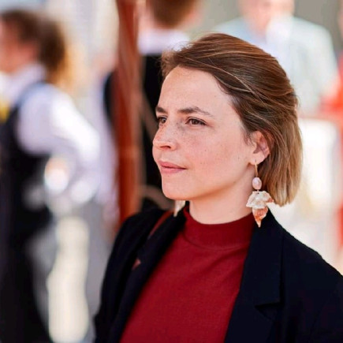
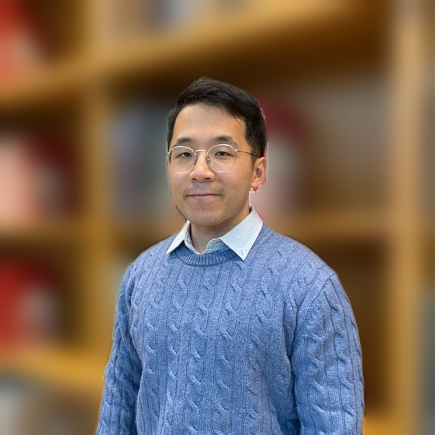
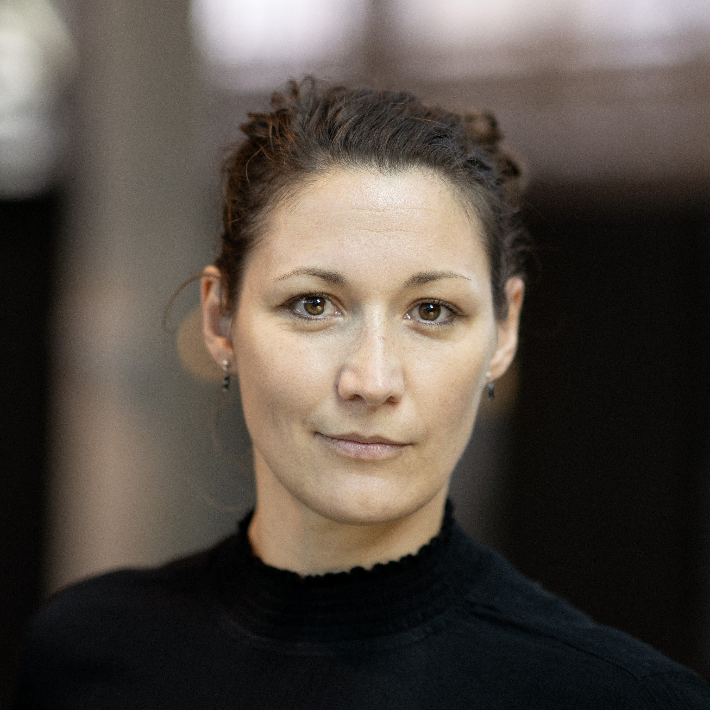
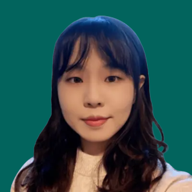
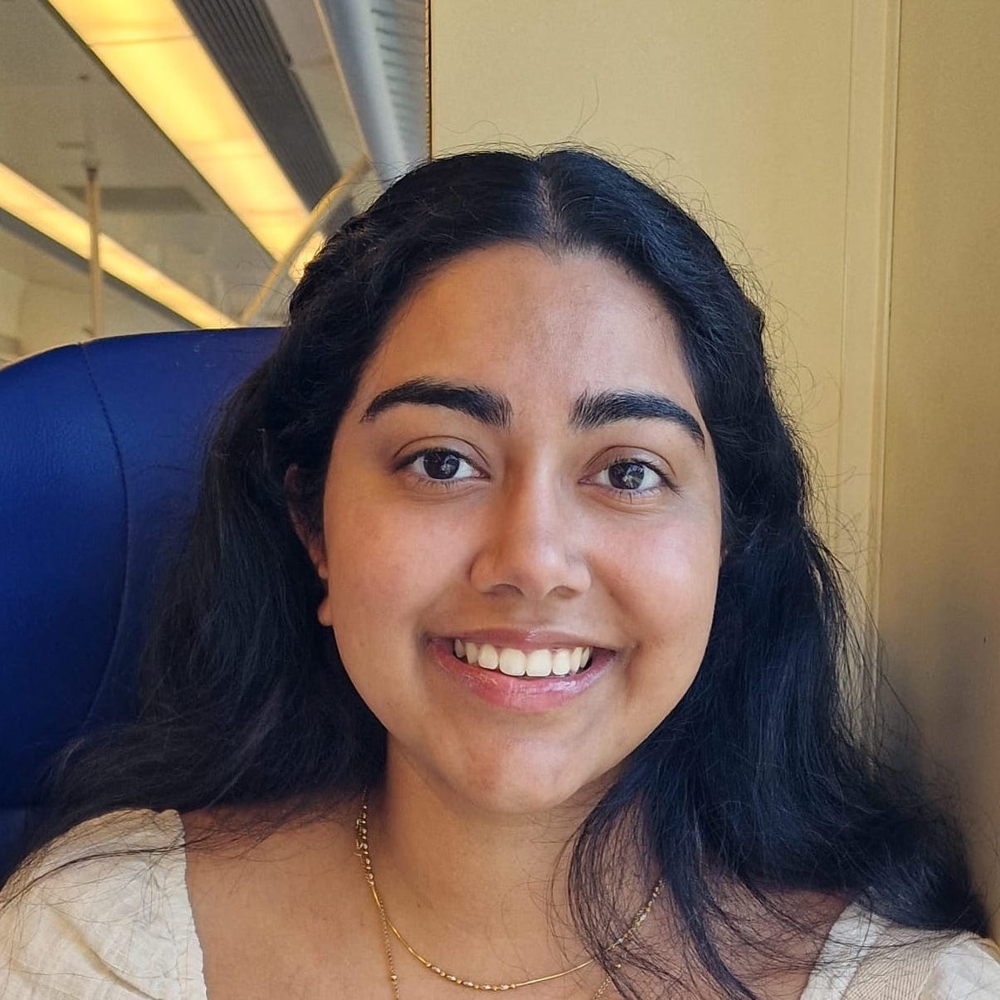
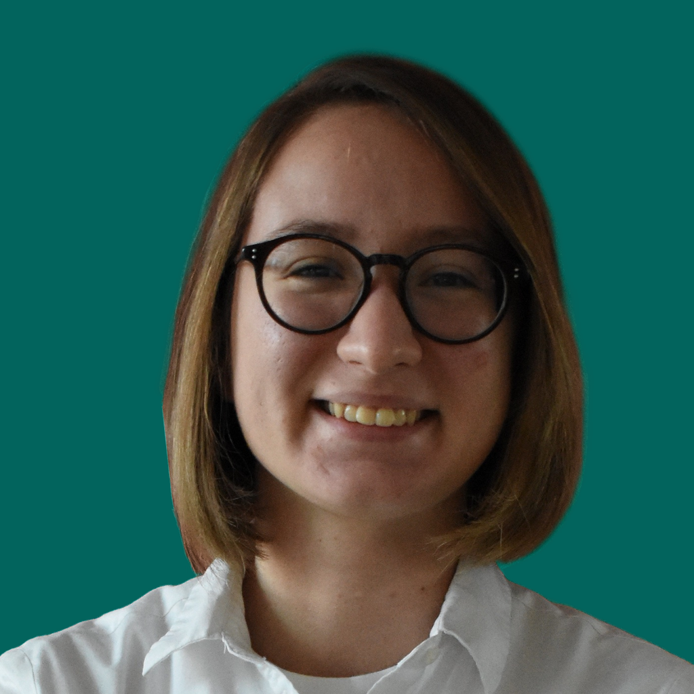
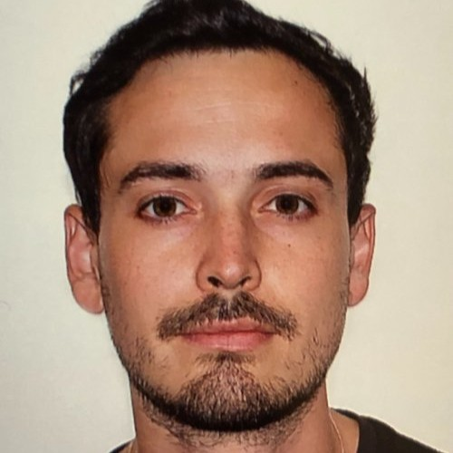
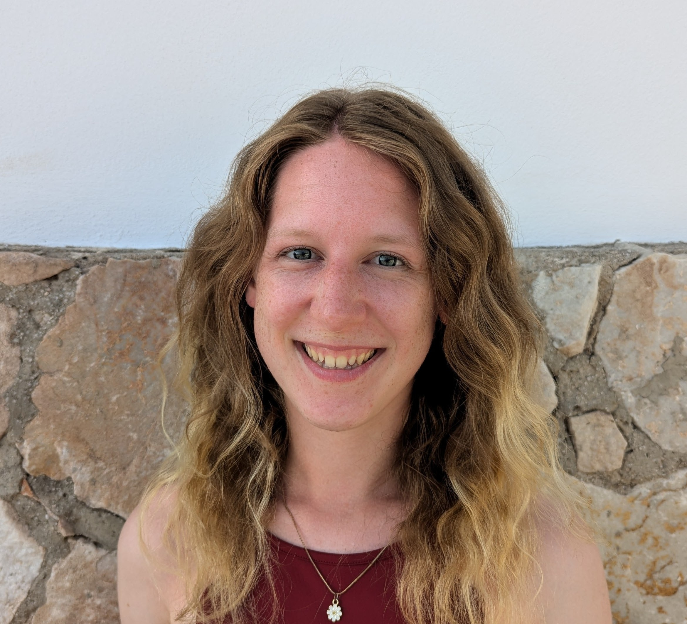
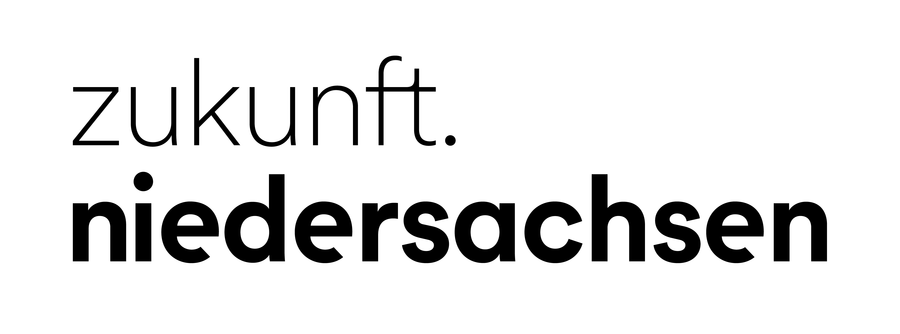

<!---
this is a WIP for the 2027 iteration of the workshop
-->

## Motivation
Linguistic diversity is one of the fundamental rights of the European Union and we are optimistic that cross-lingual AI models can play an important role in facilitating it. Cross-lingual models based on neural networks are trained on terabytes of data and have recently reached large performance gains. As the computationally expensive training of such models can only be afforded by large companies, the evaluation of cross-lingual models is driven by commercial incentives and focuses on the average quantitative performance across more than a hundred languages. The intricacies of application scenarios for low-resource languages or economically insignificant purposes are largely being overlooked and individual differences between users are underestimated. When we want to use cross-lingual models for human-centered scenarios such as cognitive modeling, language education, or use cases in the digital humanities, we quickly encounter their limitations. 

In this workshop, we want to bring together leading scholars from linguistics, cognitive science, and computer science to develop a more diverse and human-centered perspective on cross-lingual models.  We want to integrate typological theories about differences between language families, cognitive models of multilingual processing, and computational approaches toward increasing diversity in language technology.

## Important Details & Registration
**Start:** 🕒 Wednesday, March 17th, 2027, TBD  
**End:** 🕒 Thursday, March 18th, 2027, TBD  
**Where:** 📍 <a href="https://www.uni-goettingen.de/en/96209.html">Historische Sternwarte</a> in Göttingen (<a href="https://maps.app.goo.gl/6HCMp4RPkBHpusDRA">Google Maps</a>) 
Participation in the workshop is free of charge but the number of participants is limited.  
Please register using <a href="https://survey.academiccloud.de/f/191589?lang=en" target="_blank">this</a> form.  

---
## **Keynote Speakers**  
<table style="border: hidden;">
 <tr style="border: hidden;">
  <td style="border: hidden; padding: 2px; vertical-align: middle;">
  </td>
  <td style="border: hidden;"><a href="https://www.linkedin.com/in/eva-vanmassenhove/"><b>Eva Vanmassenhove</b></a> (Tilburg University, Netherlands) <em>Title: Losing our Tail, Again: (Un)Natural Selection and Multilingual LLMs</em> 
  </td>
 </tr>
 <tr style="border: hidden;">
  <td style="border: hidden; padding: 2px; vertical-align: middle;">
  </td>
  <td style="border: hidden;"><a href="https://byungdoh.github.io/"><b>Byung-Doh Oh</b></a> (NTU, Singapore) <em>Title: Moving Beyond Surprisal-Based Modeling: Parafoveal Preview and Rereading</em>
  </td>
 </tr>
</table>
---

## **Program**  
TBD

## **Posters**
TBD
  
---
## HumanCLAIM 2026 Highlights

---
## Organization Committee
<table style="border: hidden; border-collapse: collapse; width: 100%;">
 <tr style="border: hidden;">
  <td style="border: hidden; padding: 20px; vertical-align: middle; text-align: center; width: 25%;">
  </td>
  
  <td style="border: hidden; padding: 20px; vertical-align: middle; text-align: center; width: 25%;">
  </td>
  
  <td style="border: hidden; padding: 20px; vertical-align: middle; text-align: center; width: 25%;">
  </td>

  <td style="border: hidden; padding: 20px; vertical-align: middle; text-align: center; width: 25%;">
  </td>

  <!--
  <td style="border: hidden; padding: 20px; vertical-align: middle; text-align: center; width: 25%;">
  </td>
  <td style="border: hidden; padding: 20px; vertical-align: middle; text-align: center; width: 25%;">
  </td>
 -->
      
 </tr>
 <tr>
  <td style="border: hidden; padding: 5px; text-align: center; width: 25%;"><a href="https://huds.uni-goettingen.de/">Lisa Beinborn</a> (University of Goettingen)</td>

  <td style="border: hidden; padding: 5px; vertical-align: middle; text-align: center; width: 25%;"><a href="https://www.linkedin.com/in/zhuojing-huang-624a6b288">Zhuojing Huang</a> (University of Goettingen)</td>
  
  <td style="border: hidden; padding: 5px; vertical-align: middle; text-align: center; width: 25%;"><a href="https://urjakh.github.io/">Urja Khurana</a> (Vrije Universiteit Amsterdam)</td>

  <td style="border: hidden; padding: 5px; vertical-align: middle; text-align: center; width: 25%;"><a href="https://huds.uni-goettingen.de/content/team/yana_veitsman.html">Yana Veitsman</a> (University of Goettingen)</td>
 </tr>
</table>

## Contact
If you have questions about the program, you can reach the organizers via <a href="mailto:humanclaim-organizers@googlegroups.com">humanclaim-organizers@googlegroups.com</a>. 

If you are interested in humanclaim and want to stay informed about the event, send a request to join our google group at <a href="https://groups.google.com/g/humanclaim/">https://groups.google.com/g/humanclaim/</a>. 

Curious about previous editions? Visit the websites for [HumanCLAIM 2026](/workshop2026.markdown) and [HumanCLAIM 2025](/workshop2025.markdown).

---
## Funding
The workshop is funded by *zukunft.niedersachsen*, the joint science funding program of the Lower Saxony Ministry of Science and Culture and the Volkswagen Foundation.
